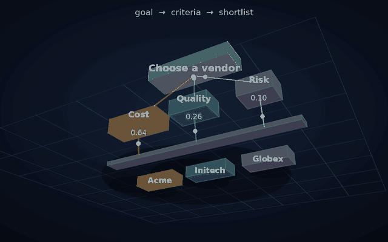
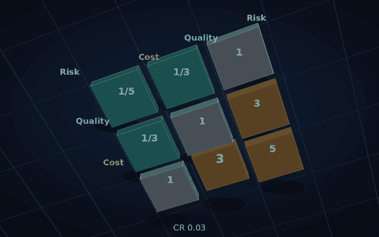
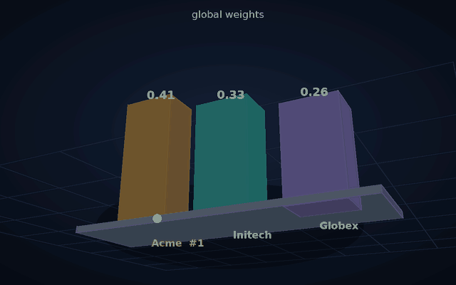

# ahp

You name a goal, the things that matter, and the options. You say which criterion matters more, and which option wins on each one. `ahp` ranks them and writes an HTML report on your machine. The files stay in a folder you own.

```bash
go install github.com/lazarok09/ahp-method/cmd/ahp@latest
ahp version
```

Needs Go 1.25.5+.

## A decision in one sitting

```bash
ahp init ./laptop-buy --title "Choose a laptop"
cd ./laptop-buy
ahp add-criterion battery "Battery life"
ahp add-criterion value "Price"
ahp add-alternative framework "Framework 13"
ahp add-alternative thinkpad "ThinkPad T14"

ahp pair set criteria battery value 3 --note "battery matters a bit more than price"
ahp compute
ahp open
```

`ahp open` writes `output/report.html`. The ranking is in that file and in `output/ranking.csv`.

Fill the other comparisons the same way. `alt:battery` is “which laptop is better on battery.” `criteria` is “which criterion matters more.” `ahp status` tells you what is still missing.

## What the report is showing

The pictures are the committed `examples/vendor-selection` workspace, the same numbers `ahp compute` writes.

<table>
  <tr>
    <td align="center" width="33%">
      
      <br><b>Structure</b>
      <br><sub>Goal, how much each criterion weighs, one shortlist</sub>
    </td>
    <td align="center" width="33%">
      
      <br><b>Comparisons</b>
      <br><sub>How much more one side matters. CR 0.03</sub>
    </td>
    <td align="center" width="33%">
      
      <br><b>Ranking</b>
      <br><sub>One score per option</sub>
    </td>
  </tr>
</table>

A consistency ratio above 0.10 means two comparisons disagree. `ahp status` points at which one to fix. The ranking is still computed, and the report says the matrix is inconsistent.

Try the example:

```bash
ahp compute -w examples/vendor-selection
ahp open    -w examples/vendor-selection
```

## Buying something

Record the price and where it came from, then let the tool turn those numbers into comparisons. You still accept them.

```bash
ahp set-attribute framework value 8990 --unit BRL --source "loja oficial Pix"
ahp set-attribute thinkpad  value 7490 --unit BRL --source "loja oficial Pix"
ahp constrain value --min 5000 --max 10000 --unit BRL --prefer lower
ahp rate --criterion value --prefer lower
ahp doctor --purchase
ahp compute
```

The longer walk is [QUICKSTART](./docs/QUICKSTART.md).

## If you use an agent

The same binary speaks MCP. The agent writes comparisons as drafts (`status=proposal`). You run `ahp apply` when you agree. Details: [mcp.md](./docs/mcp.md).

## Go further

| Command | What it answers |
|---------|-----------------|
| `ahp status` | What is filled in, and what to do next |
| `ahp explain` | Why the winner scored what it scored |
| `ahp sensitivity` | Whether a small weight change flips the rank |
| `ahp docs <command>` | Help for one command |

Build from this repo with `go build -o bin/ahp ./cmd/ahp`. Tests: `go test ./...`.

[Schema](./docs/schema.md) · [Architecture](./docs/architecture.md) · [Contributing](./CONTRIBUTING.md) · [License](./LICENSE)
